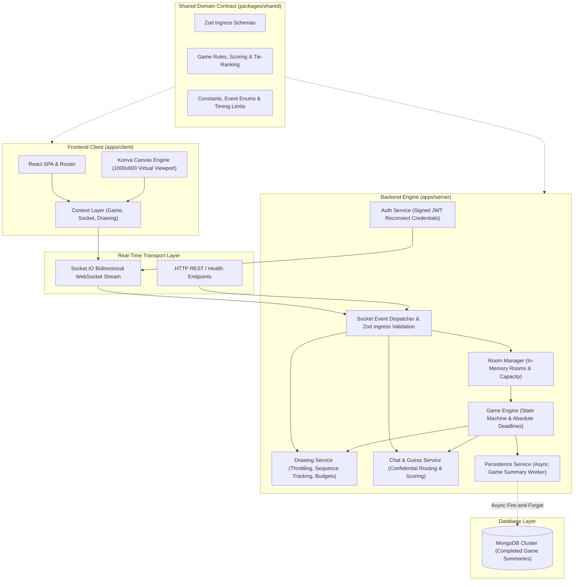
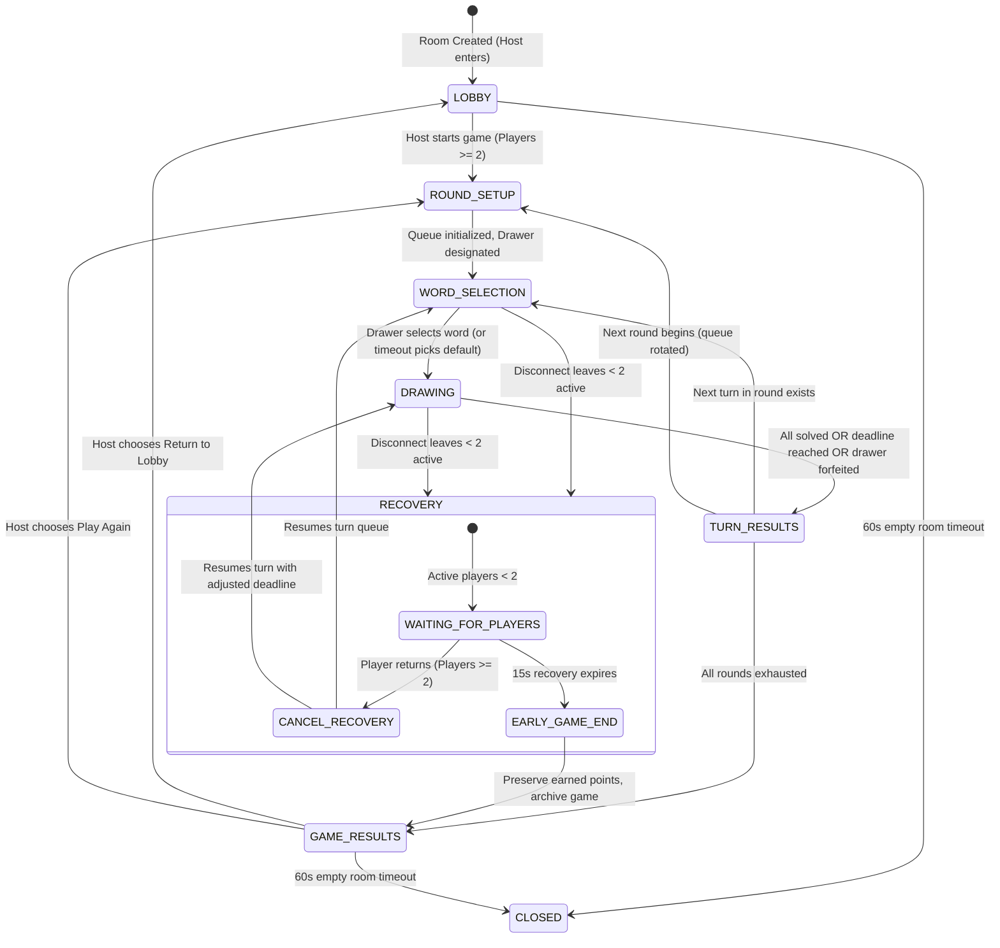
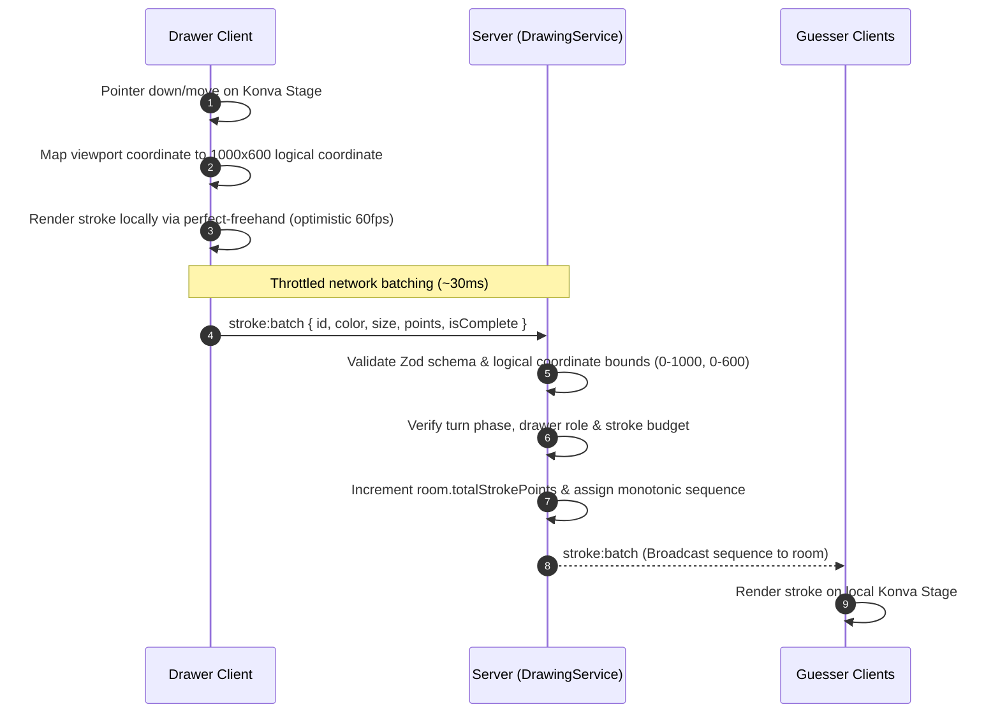

# Doodlr

> **Draw fast. Guess faster.**
> A high-concurrency, server-authoritative multiplayer drawing-and-guessing platform built on Node.js, Express, Socket.IO, MongoDB, and React.

[](https://doodlr-six.vercel.app)
[](https://doodlr-kxqv.onrender.com)
[](LICENSE)

---

## Table of Contents

- [Problem Statement](#problem-statement)
- [Target Users](#target-users)
- [Solution](#solution)
- [Key Features](#key-features)
- [Tech Stack](#tech-stack)
- [Architecture](#architecture)
  - [High-Level System Topology](#high-level-system-topology)
  - [Package & Monorepo Boundaries](#package--monorepo-boundaries)
  - [Game State Machine & Lifecycle](#game-state-machine--lifecycle)
  - [Authoritative Timing & Synchronization](#authoritative-timing--synchronization)
  - [Fault Tolerance & Recovery Protocol](#fault-tolerance--recovery-protocol)
  - [Vector Canvas & Stroke Streaming Protocol](#vector-canvas--stroke-streaming-protocol)
  - [Scoring Engine & Guess Confidentiality](#scoring-engine--guess-confidentiality)
- [Local Setup](#local-setup)
- [Environment Variables](#environment-variables)
- [Deployment](#deployment)
- [Health Monitoring & Verification](#health-monitoring--verification)

---

## Problem Statement

Online multiplayer drawing games frequently suffer from critical architectural and networking flaws:

1. **Client-Clock Desynchronization & Tampering:** Client-side countdown timers drift due to background tab throttling, mobile sleep cycles, or local clock manipulation, resulting in uneven turn durations and unfair point calculations.
2. **Secret Word & Guess Leaks:** Naive WebSocket implementations broadcast secret words or raw guess streams to all clients, allowing players to inspect network traffic or DOM state to cheat.
3. **Fragile Session Management:** Brief network drops, mobile cell tower handoffs, or browser refreshes immediately terminate room membership, eject hosts, or freeze turn queues.
4. **Heavy Infrastructure Overhead:** Many implementations demand complex multi-node setups (e.g., Redis pub/sub clusters and external caches) even for private games, increasing latency, operational costs, and deployment friction.
5. **Screen Resolution Inconsistency:** Raster canvas transmissions fail or blur when scaled across differing mobile, tablet, and desktop display aspect ratios.

---

## Target Users

- **Casual Gaming Groups & Remote Teams:** Friends and distributed colleagues seeking an instant, zero-friction party game that requires no mandatory account registration, third-party authentication, or software downloads.
- **Educators & Event Organizers:** Hosts who need private, controlled game rooms with customizable turn durations, round counts, and curated word categories.
- **Software Engineers & System Architects:** Developers looking for a production-grade reference implementation of a server-authoritative, real-time WebSocket state machine with resilient disconnect handling and resolution-independent vector graphics streaming.

---

## Solution

Doodlr delivers an authoritative, single-server multiplayer engine engineered specifically for private room sessions:

- **Server-Authoritative Timing:** Eliminates client-side clock drift by enforcing monotonic server deadlines ($\text{room.deadlineAt}$) for all turn authorizations and score calculations.
- **Confidential Guess & Role Routing:** Employs role-gated Socket.IO message routing. Secret words never reach guesser runtimes, and incorrect guesses are masked from solved players and spectators.
- **Zero-External-Cache Architecture:** Runs active room state, vector strokes, and presence in optimized Node.js process memory, with completed games archived asynchronously to MongoDB.
- **Resilient Reconnection Protocols:** Issues signed JWT reconnect credentials, preserves games through a 10-second drawer grace window, initiates an isolated 15-second room recovery state if participants drop below quorum, and retains abandoned rooms for 60 seconds.
- **Normalized Vector Canvas Streaming:** Normalizes all drawing interactions to a fixed $1000 \times 600$ logical coordinate space, streaming throttled vector stroke batches rather than heavy raster image blobs.

---

## Key Features

- **Instant Private Game Creation:** Generate private rooms with cryptographically secure 6-character invite codes and direct shareable URLs.
- **Host Room Customization:** Configure player capacities (2–8 players), full game rounds (1–5 rounds), turn drawing durations (30s, 45s, 60s, 75s, 90s), hint toggling, and built-in category filters (Animals, Food, Objects, Actions, Nature).
- **High-Performance Vector Canvas:** 60 FPS local pointer tracking via `perfect-freehand`, ~30ms network batching, 12-swatch quick palette, hex color picker, adjustable brush sizes (Fine to Marker), and monotonic undo/clear synchronization.
- **Real-Time Guess Secrecy & Feed:** Filtered live guess feed where raw guesses route only to the Drawer and unsolved guessers, automatically converting correct submissions into global solved announcements.
- **Time-Decay Scoring & Drawer Incentives:** Dynamic score decay rewarding faster guesses (100–500 points) and performance bonuses for drawers (50 points per unique solver, voided if forfeited).
- **Automated Progressive Letter Hints:** Automatic revelation of unrevealed letters at 20s and 45s, keeping punctuation, spaces, and digits visible while restricting hint candidates strictly to alphabet characters.
- **Standard Competition Tie-Ranking:** Automatic calculation of final standings using competition ranking (`[1, 1, 3]`), breaking ties deterministically by earliest room join timestamp.
- **Token-Based Refresh Reconnect:** Signed JWT reconnect tokens allow players to refresh or recover from drops without losing accumulated scores, roles, or room seats.
- **Truthful Degraded Mode:** If MongoDB is offline, active in-memory games continue without interruption, truthfully reporting persistence status via `/health`.

---

## Tech Stack

| Domain | Technology | Purpose |
|---|---|---|
| **Architecture** | npm Workspaces | Monorepo layout isolating `apps/*` and `packages/*` |
| **Backend Runtime** | Node.js (v24 LTS / v20+) | High-throughput asynchronous event-loop execution |
| **HTTP Server** | Express v4 | REST endpoints, static routing, and health checking |
| **Real-Time Transport** | Socket.IO v4 | WebSocket transport with fallback, rooms, and binary buffering |
| **Database & ODM** | MongoDB & Mongoose v8 | Historical game summary archive and document indexing |
| **Runtime Validation** | Zod v3 | Schema validation on environment and untrusted socket events |
| **Security & Auth** | Helmet, CORS, JSONWebToken | HTTP header hardening, origin whitelisting, session tokens |
| **Structured Logging** | Pino & Pino-Pretty | Low-overhead JSON structured logging |
| **Frontend Framework** | React 18 & Vite v6 | Single-page client architecture and fast module bundling |
| **Canvas Graphics** | Konva & React-Konva | High-performance HTML5 2D canvas scene graph |
| **Vector Smoothing** | perfect-freehand | Pressure-sensitive, responsive polygonal stroke generation |
| **Client Routing** | React Router v7 | URL routing, route param extraction, and invite code handling |

---

## Architecture

### High-Level System Topology



### Package & Monorepo Boundaries

- **`packages/shared`:** Zero-dependency domain contract consumed by both server and client. Houses game constants (`CANVAS_WIDTH = 1000`, `CANVAS_HEIGHT = 600`), socket event definitions, Zod validation schemas, and pure functions for scoring, masking, and rankings.
- **`apps/server`:** Authoritative Node.js service managing room lifecycle, game state transitions, timer intervals, socket dispatching, and persistence.
- **`apps/client`:** Browser client responsible for mounting contexts, rendering the Konva stage, capturing normalized pointer events, and presenting active stage views.

### Game State Machine & Lifecycle



#### In-Game Role Matrix

| Role | Transition Trigger | Operational Privileges |
|---|---|---|
| `DRAWER` | Selected by cyclic queue at turn start | Receives secret word; broadcasts vector strokes; executes undo/clear; immune to guessing. |
| `ACTIVE_GUESSER` | Assigned to connected players at round setup | Receives word mask; submits real-time guesses; blocked from drawing. |
| `SOLVED` | Assigned immediately upon submitting exact match | Word revealed; locked from guessing; receives raw guesses from remaining unsolved players. |
| `SPECTATOR` | Assigned to users joining during an active round | Receives word mask; views live canvas; blocked from guessing/drawing until next full round boundary. |

### Authoritative Timing & Synchronization

Multiplayer fairness is enforced via server timestamps:

1. **Absolute Deadline Anchor:** When a turn starts, the server sets:
   $$\text{room.deadlineAt} = \text{Date.now()} + (\text{durationSeconds} \times 1000)$$
2. **Deterministic Guess & Stroke Evaluation:** Incoming guesses and drawing strokes are authorized against remaining time derived on the fly:
   $$\text{remainingSeconds} = \max\left(0, \left\lceil \frac{\text{room.deadlineAt} - \text{Date.now()}}{1000} \right\rceil\right)$$
3. **Decoupled Interval Broadcasts:** A 1-second display interval broadcasts time to clients. Event-loop lag or background tab throttling cannot artificially extend turn limits.
4. **Generation Guarding:** Every turn increments `room.turnGen`. Expired timers check generation identity before executing, silently discarding stale callbacks.

### Fault Tolerance & Recovery Protocol

- **Drawer Drop in `WORD_SELECTION`:** Pauses selection timer and arms a 10s grace window. If drawer reconnects, choices are re-sent. If grace expires, turn is forfeited (0 points) and engine advances.
- **Drawer Drop in `DRAWING`:** Turn countdown is paused and guessing is suspended for 10s. If drawer reconnects, deadline is recalibrated and turn resumes.
- **Room Recovery (< 2 Active Players):** If disconnections leave $< 2$ active players, the room enters `RECOVERY` for 15s. Recovery timers (`recoveryTimer`, `recoveryCountdownTimer`, `recoveryGen`) are decoupled from turn timers (`clearRecoveryTimers()` vs `clearTurnTimers()`). If a player reconnects, the existing turn queue resumes without resetting to turn 0.
- **Reconnection Tokens:** Signed JWTs allow players to refresh or reconnect into their exact seat and score.
- **Deliberate Leave Handling:** Clicking **Leave Room** invalidates session credentials, marks the player `LEFT`, and permanently excludes them from reclaiming the old seat.
- **Empty Room Cleanup:** When all players disconnect, a 60-second timer is armed (`emptyRoomTimer`). Any reconnection cancels the timer; expiration garbage-collects the room.

### Vector Canvas & Stroke Streaming Protocol



- **Logical Viewport:** Drawing coordinates are anchored to a $1000 \times 600$ grid (`CANVAS_WIDTH` / `CANVAS_HEIGHT`) and scaled dynamically by the client.
- **Network Batching:** Point events are recorded locally and emitted in batches throttled to ~30ms (~33 emissions/sec).
- **Resource Constraints:** `MAX_STROKES_PER_TURN = 500`, `MAX_STROKE_POINTS = 1000`. Cumulative points are tracked incrementally (`room.totalStrokePoints`) to prevent memory spikes.
- **Monotonic Mutations:** Undo and clear actions broadcast server sequence numbers, ensuring state parity.

### Scoring Engine & Guess Confidentiality

- **Confidential Routing:** Incorrect guesses route exclusively to the Drawer and active unsolved guessers; raw text is hidden from solved players and spectators.
- **Normalization:** Guesses are trimmed, lowercased, and stripped of diacritics/accents via Unicode normalization (`NFD`).
- **Guesser Scoring Formula:**
  $$\text{GuesserScore} = \text{round}\left(100 + 400 \times \frac{\text{remainingSeconds}}{\text{turnDuration}}\right)$$
- **Drawer Bonus Formula:**
  $$\text{DrawerBonus} = \text{uniqueSolversCount} \times 50 \quad (\text{0 if forfeited})$$
- **Progressive Letter Hints:** Automates letter reveals at 20s and 45s using `isMaskableLetter()` (`/^[a-zA-Z]$/`), keeping digits, spaces, and punctuation permanently visible.

---

## Local Setup

### Prerequisites

- **Node.js:** v20.x or higher (v24.x recommended)
- **npm:** v10.x or higher
- **MongoDB:** v6.x or higher (optional; memory-only fallback available)

### 1. Clone & Install Dependencies

```bash
git clone https://github.com/SirviTusharChoudhary/Doodlr.git
cd Doodlr

# Install dependencies across all workspaces
npm run install:all
```

### 2. Configure Environment

Create a `.env` file in the project root:

```bash
cp .env.example .env
```

### 3. Run Development Servers

```bash
# Start backend (port 4000) and frontend (port 5173) concurrently
npm run dev

# Or start workspaces in separate terminal sessions:
npm run dev:server    # Backend server with node --watch
npm run dev:client    # Vite frontend development server
```

### 4. Build & Verify

```bash
# Compile frontend production bundle
npm run build

# Run syntax check across all server & shared modules
find apps/server/src packages/shared/src -name "*.js" -exec node -c {} +
```

---

## Environment Variables

All configuration is managed through environment variables validated at startup via Zod. Never commit real credentials to version control.

| Variable | Target | Type | Default | Description |
|---|---|---|---|---|
| `PORT` | Server | Integer | `4000` | Port for Express HTTP server and Socket.IO WebSocket transport. |
| `NODE_ENV` | Server | String | `development` | Runtime environment (`development`, `production`, `test`). In production, CORS restricts to `CLIENT_ORIGIN`. |
| `CLIENT_ORIGIN` | Server | URL | `http://localhost:5173` | Allowed frontend origin for HTTP CORS and Socket.IO handshake verification. |
| `JWT_SECRET` | Server | String | *Required* | High-entropy secret key (min 16 chars) used to sign guest reconnect tokens. |
| `MONGODB_URI` | Server | URI | `mongodb://127.0.0.1:27017/doodlr` | Connection string for MongoDB database cluster used for game summaries. |
| `VITE_SERVER_URL` | Client | URL | `http://localhost:4000` | Backend API and WebSocket gateway URL consumed by the client. |

---

## Deployment

Provide links or instructions for accessing the final application:

| Resource | URL | Description |
| :--- | :--- | :--- |
| **Live Application** | [https://doodlr-six.vercel.app](https://doodlr-six.vercel.app) | Production web client hosted on Vercel |
| **Backend API & WebSockets** | [https://doodlr-kxqv.onrender.com](https://doodlr-kxqv.onrender.com) | Realtime game server hosted on Render |
| **Health Check Endpoint** | [https://doodlr-kxqv.onrender.com/health](https://doodlr-kxqv.onrender.com/health) | Authoritative server & database status check |
| **GitHub Repository** | [https://github.com/SirviTusharChoudhary/Doodlr](https://github.com/SirviTusharChoudhary/Doodlr) | Source code repository |

### Accessing the Application

1. Navigate to [https://doodlr-six.vercel.app](https://doodlr-six.vercel.app) on any desktop or mobile browser.
2. Enter your display name and choose a character avatar.
3. Click **Create Room** to generate a new private room code, or enter an existing code to join a match.
4. Share the room code or invite link with other players to start drawing and guessing in real time.

---

## License

This project is licensed under the MIT License.
